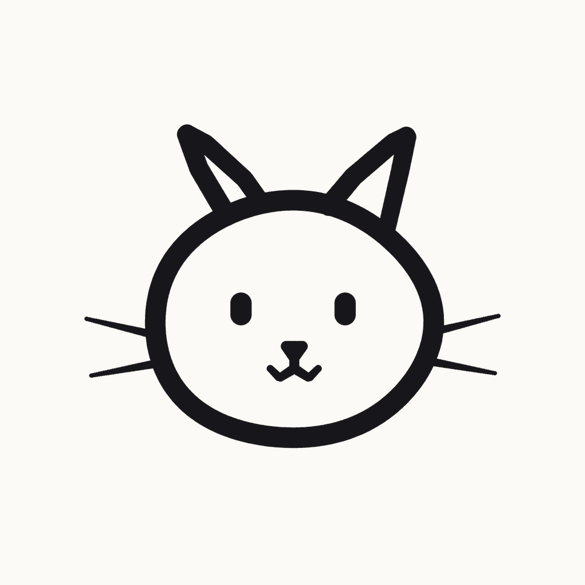
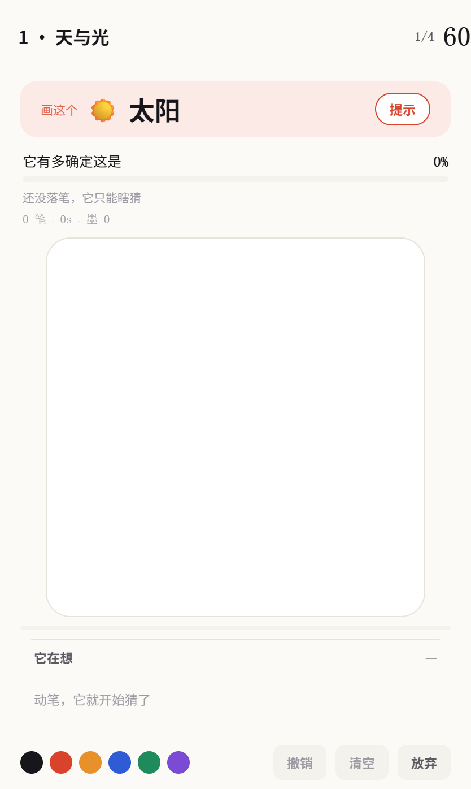
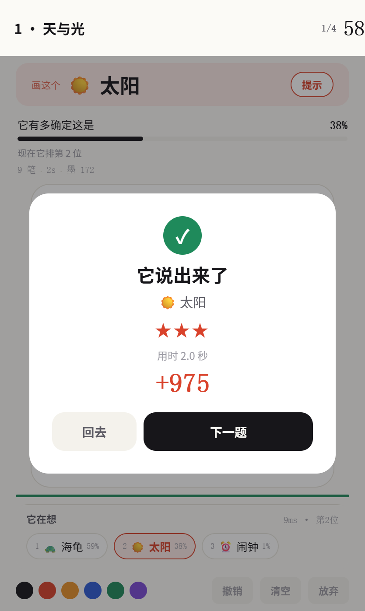
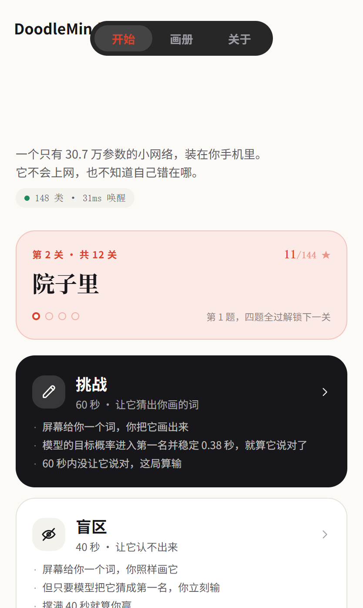
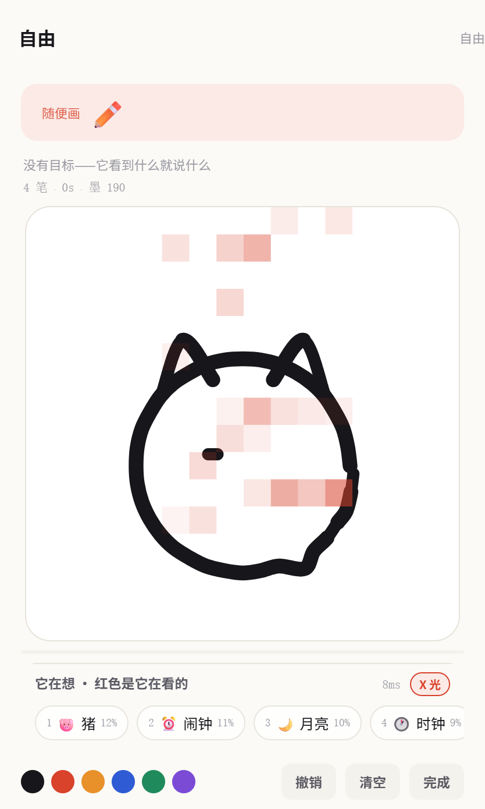
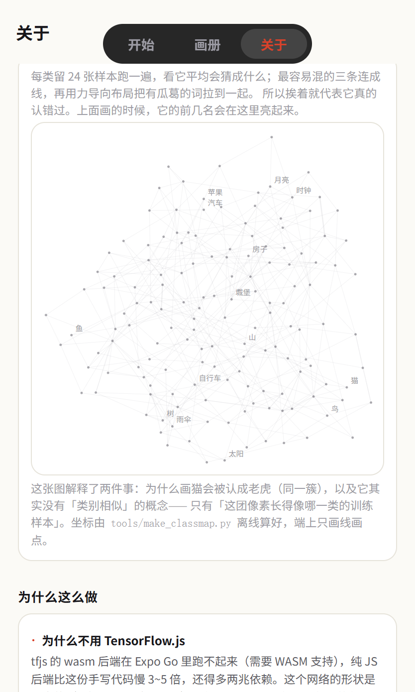

<div align="center">



# DoodleMind

### 你画，一个 310 KB 的小网络猜。

它躲在你手机里，不上网、不联网、不认识你。你画的每一笔它都在看。

<sub>手写 TypeScript 推理 · 148 个类别 · 307K 参数 · 单次 8 ms · 零网络代码</sub>

<br>

<a href="https://github.com/ZHIFANSONG/DoodleMind/releases/latest"></a>


<a href="LICENSE"></a>

<br>
<br>





</div>

---

## 为什么好玩

**它是一个黑箱。** 平常的你画我猜，对手是人，你知道他在想什么。这里的对手是 4 层卷积网络，它对你不透明——所以游戏变成了逆向工程：什么轮廓能让它说出「长颈鹿」？为什么加了斑纹它反而更懵？为什么脖子画长一点概率跳了 30 个点？

**它边看边说。** 手指还没抬起来，候选栏已经在重排了。画到一半它就敢抢答，画错了会改主意。

**你可以反过来欺负它。** 盲区模式里，目标是**让它认不出来**——你画得越像越容易输。

**它有进度。** 12 关，由易到难，四题全过才解锁下一关，按用时给星。进度存在本机，删了 App 就没了——这里的「云同步」不是做不到，是故意没有。

**过关有一声盖章。** 两个音效是合成的（`tools/make_sounds.py`，两行正弦加指数包络），总共 21 KB。手机按了静音键就不会响。

---

## 装到 iPhone

不用 Mac、不用 Xcode、不用开发者账号。

1. 从 [Releases](https://github.com/ZHIFANSONG/DoodleMind/releases/latest) 下 `DoodleMind-unsigned.ipa`
2. 用 [Sideloadly](https://sideloadly.io) / [AltStore](https://altstore.io) / [SideStore](https://sidestore.io) 自签安装（包里有 8 个嵌套 framework，全部用同一张证书重签）
3. 免费 Apple ID 的签名 7 天过期，到期重签一次即可

> 包是**未签名**的。签名是安装那一步的事，仓库只负责产出干净的 ipa。

---

## 三种玩法 + 一条通关线

| | 谁出题 | 怎么算赢 |
|---|---|---|
| **闯关** | 12 关 × 4 个词，由易到难 | 每关四题全部画出来就解锁下一关；按用时给 1~3 星，共 144 星 |
| **挑战** | App 给词，60 秒 | 让它说出这个词（目标词进前二且概率 ≥ 30%，稳定 0.38 秒） |
| **盲区** | App 给词，40 秒 | 画得让它认不出来。被看穿就输，撑满 40 秒就赢；墨太少不算 |
| **自由** | 没有题 | 随便画，看它怎么想 |

盲区是反向的：你和一个固定权重的网络对抗，而它的判决标准写在明面上。

判定不是「top-1 命中」这么简单——挑战放行到「第二名」是因为真人画的和 QuickDraw 差得远（我画的太阳它一直以为是海龟，但海龟之下就是太阳），盲区则必须是第一名才算看穿。细节在 [设计笔记](docs/DESIGN.md)。

---

## 它不只是猜——你还能反过来看它

**X 光：它在看你画的哪一块。** 点一下候选栏右边的「X 光」，画布上会浮出一层热区——那是
`∂logit/∂像素`，也就是"这一格像素变亮一点，它的结论会变多少"。手写的反向传播，四种算子
（dense / depthwise / pointwise / maxpool）的转置全部自己写，和 PyTorch autograd 逐元素
对上（cos = 1.000000，最大偏差 2e-6）。一次 20 ms，内部节流到 180 ms，叠在画上是这样：



**它把哪些词搞混。** 每类留 24 张样本跑一遍，看它平均猜成什么，把最容易混的三条连成线，
再用力导向布局摆开。于是「画猫被认成老虎」不再是玄学——它们在图上就是同一簇：



这两张图都不是设计稿：热力图来自真的梯度，连线来自真的误判。

---

| | |
|---|---|
| 参数量 | 306,964 |
| 权重 | 310 KB（int8 + base64，打包进 App） |
| 结构 | `dense3x3 1→48` ↓ `dw+pw →160` ↓ `dw+pw →320` ↓ `dw+pw →512` → GAP → FC |
| 输入 | 32×32 灰度，笔半径 1px |
| 单次推理 | 8 ms（纯 JS，无 WebGL、无 WASM、无 tfjs） |
| 类别 | 148 · 语料 QuickDraw 66.6 万张 |
| 网络权限 | 无。App 里没有一行网络代码 |

为什么是可分离卷积、为什么 int8 只量化权重、为什么不用 tfjs——都在 [docs/DESIGN.md](docs/DESIGN.md)。

---

## 本地跑

```bash
npm install
npx expo start          # iPhone 装 Expo Go，扫码
```

Windows / Linux 上都能开发，真机热重载。出 ipa 靠 GitHub Actions（`.github/workflows/ios.yml`）。

```bash
npx tsc --noEmit && npx eslint src   # 类型 + lint
npm run check                        # 四道闸门：栅格化 / 推理一致率 / 反向传播 / 玩法状态机
```

训练（需要 PyTorch + QuickDraw 原始笔画）：

```bash
python tools/fetch_data.py --per-class 4500
python tools/train.py --epochs 70 --batch 256 --per-class 4500 --arch sep --width 48,160,320,512 --device cuda
python tools/export_model.py --ckpt doodlenet_sep.pt --name doodlemind-v4
```

---

## 目录

```
src/
  app/(tabs)/        开始 / 画册 / 关于（各带原生大标题导航栏）
  app/play.tsx       游戏页
  components/        画布、判读区、原生控件封装（kit.ios.tsx 走 SwiftUI）
  lib/               model.ts 推理引擎 · raster.ts 栅格化 · session.ts 判定 · modes.ts 三套规则
tools/               数据、训练、导出、三道闸门、CDP 截图
.github/workflows/   出未签名 ipa
docs/DESIGN.md       全部设计取舍
```

---

## 已知限制

- 只有 148 个词，冷门画法它不认识；32×32 会吃掉细枝末节。
- 它看不见颜色和手速——只看到墨的分布。
- 用私有 API 的做法一概没碰，才能用 Expo Go 直接跑。

## 致谢

模型数据来自 Google [QuickDraw](https://quickdraw.withgoogle.com/data)（CC BY 4.0，5000 万张涂鸦）。界面用 Expo Router / `@expo/ui` 的 SwiftUI 控件。整体气质参考了 [MiniWatts](https://github.com/mickeu/miniwatts) 那种「单一用途硬核小工具」的做法。

## License

MIT
